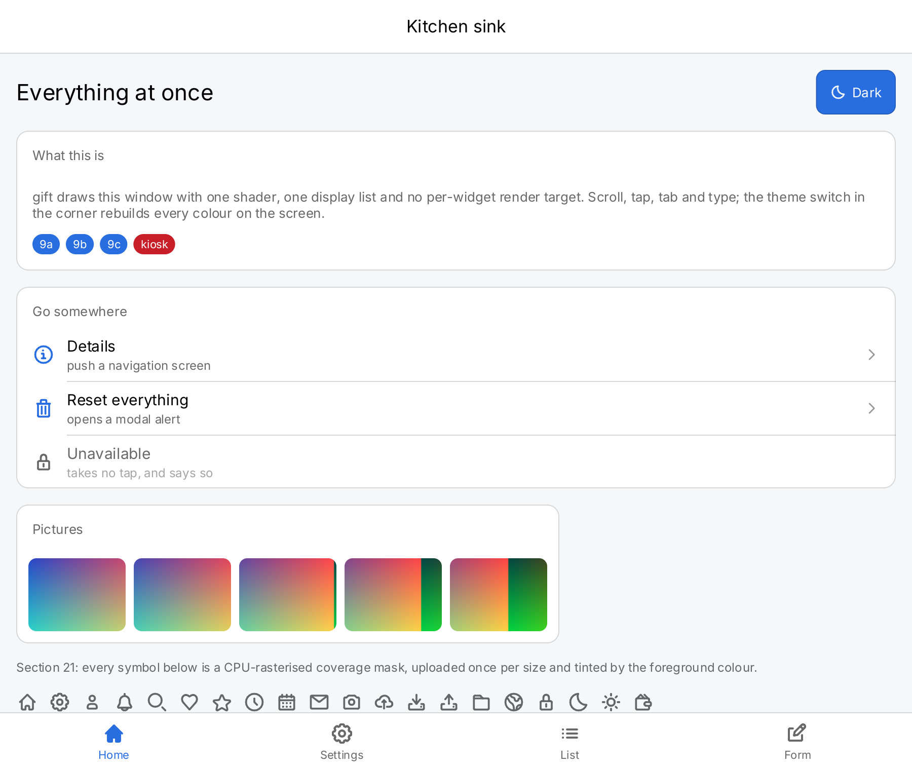
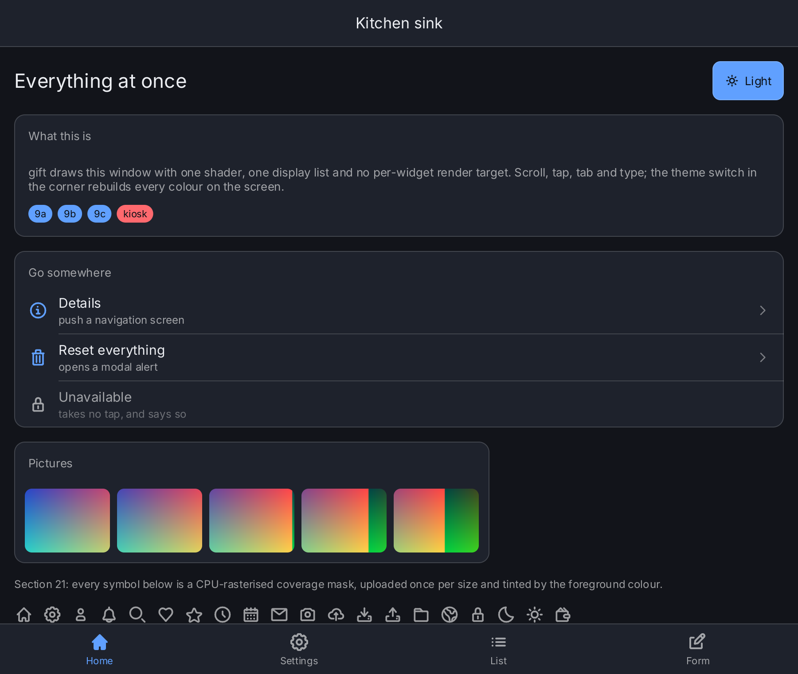


  

  Source on GitHub
  



  Desktop and kiosk interfaces&nbsp; in pure Go



  Declarative views, typed state and a GPU renderer built on Ebitengine.&nbsp; No browser, no WebView, no C compiler.




<figure class="gift-shot" style="max-width: 720px">
  
  
</figure>


  
  
  
  
  
  
  
  
  

